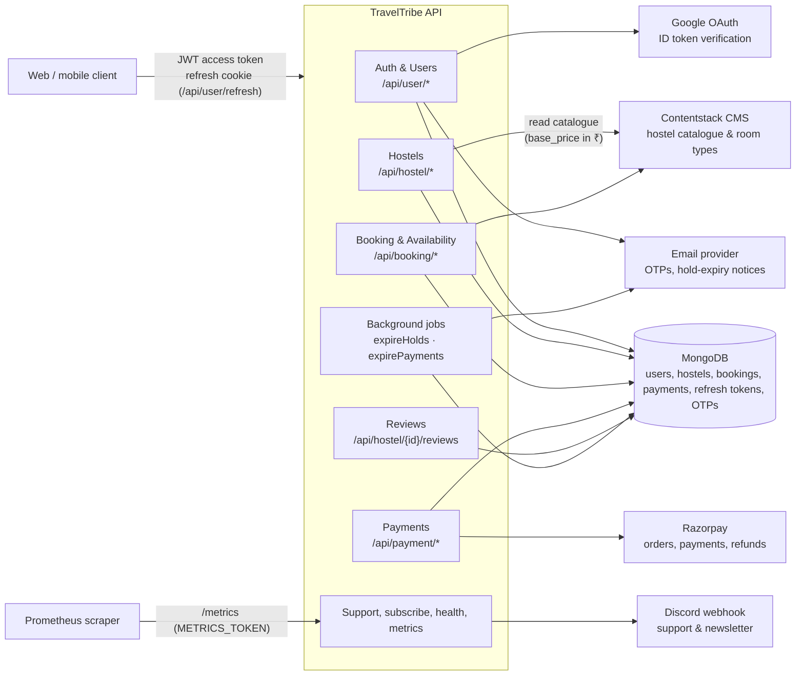
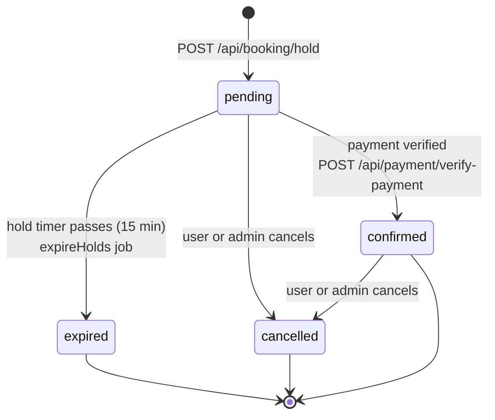
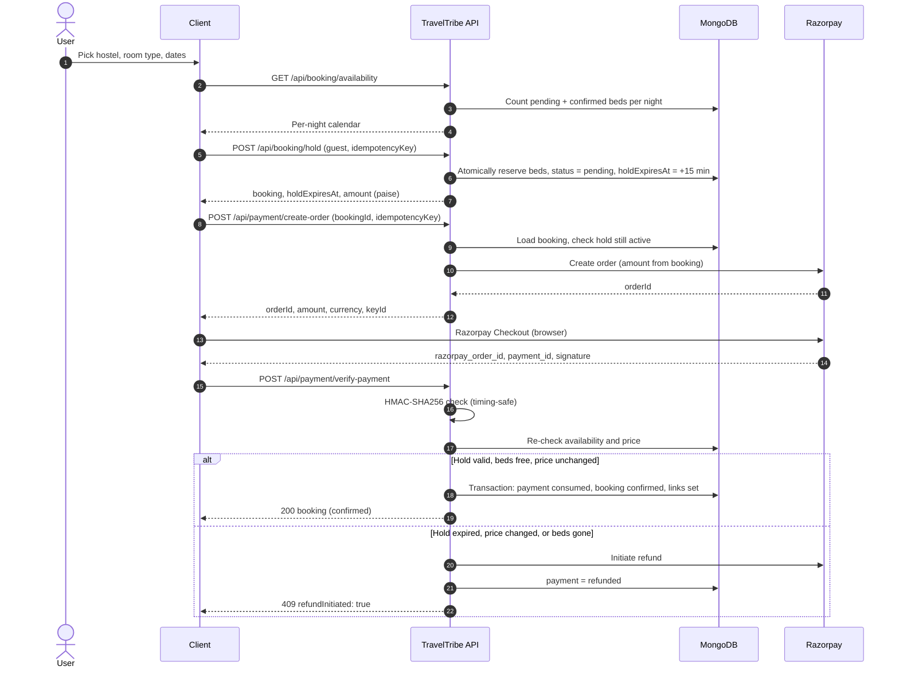
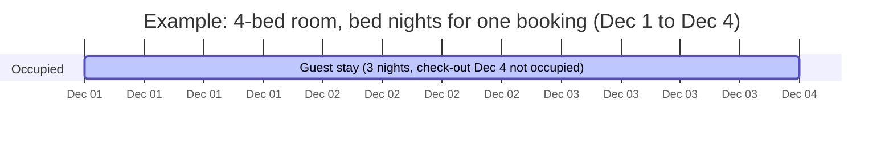
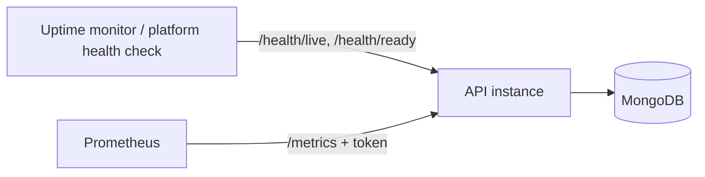

# TravelTribe API

Backend for TravelTribe, a hostel booking platform built around a **hold-first reservation model**. A user reserves a bed for 15 minutes, pays through Razorpay, and the booking is confirmed only after the server verifies the payment and re-checks availability and price.

API version: `2.1.0` · Spec: [`openapi.yaml`](./openapi.yaml) (OpenAPI 3.1)

## Contents

- [Architecture](#architecture)
- [Booking lifecycle](#booking-lifecycle)
- [Booking flow](#booking-flow)
- [Inventory model](#inventory-model)
- [Money handling](#money-handling)
- [Authentication](#authentication)
- [Background jobs](#background-jobs)
- [Endpoints](#endpoints)
- [Error handling](#error-handling)
- [Observability and health](#observability-and-health)
- [Environments](#environments)

## Architecture



### Component responsibilities

| Component | Responsibility |
|---|---|
| Auth & Users | Signup, login, Google sign-in, rotating refresh tokens, OTP password reset, admin role management. |
| Hostels | Proxies Contentstack for listings. Lazily creates the MongoDB hostel record on first access. |
| Booking & Availability | Computes per-night availability, creates holds, and serves a user's bookings and receipts. |
| Payments | Creates Razorpay orders from server-computed amounts, verifies signatures, confirms bookings, and issues refunds. |
| Reviews | Lets users with a confirmed booking review a hostel. One review per booking. |
| Background jobs | Expire stale holds and unpaid payment orders. |

### Source of truth

- **Contentstack** owns hostel content and prices as entered by editors (`base_price`, in rupees).
- **MongoDB** owns everything transactional: bookings, inventory state, payments, users, and reviews.
- **Razorpay** owns payment state and money movement. The server stores the link between its orders and our bookings.

## Booking lifecycle

A booking moves through four states. Only `pending` and `confirmed` hold inventory.



Every transition is appended to `statusHistory` with the previous state, new state, timestamp, actor, and reason.

## Booking flow

Booking takes five steps. The server sets the price, and the client never sends an amount.



### Why the server re-checks at verify time

A hold lasts 15 minutes, and checkout can take longer. Before confirming, verify-payment checks that the hold has not expired, that beds are still free, and that the price has not changed. If any check fails, the user is refunded rather than charged for a booking they cannot get.

## Inventory model

- `room_types[].total_beds` is the physical capacity of a room type. It does not change.
- Availability for a night is `total_beds − (bookings in status pending or confirmed that cover that night)`.
- A stay covers the nights from `checkIn` up to, but not including, `checkOut`. Check-in day is occupied. Check-out day is free, so one guest can check out and another can check in on the same day.
- Stays must be between **1 and 90 nights**, and `checkIn` cannot be in the past.



## Money handling

- All amounts are stored and returned in **paise** (integers). ₹2,000 is `200000`.
- Contentstack stores `base_price` in **rupees**. The server converts it to `price_per_night` in paise when it creates or reads a hostel record.
- `amount = price_per_night_snapshot × nights`. The price is copied onto the booking at hold time, so later CMS edits do not change existing bookings. Verification still compares the current price and fails the booking if it has changed.
- Clients never send `amount`, `price`, or `receipt`.

## Authentication

- **Access token:** a JWT (`Authorization: Bearer <token>`) valid for 15 minutes.
- **Refresh token:** an HttpOnly cookie scoped to `/api/user/refresh`. It rotates on every use. Reusing a token that has already been rotated returns `403`.
- **Logout** revokes the refresh token and always returns `200`.
- **Password reset:** a 6-digit OTP is emailed. It allows 5 verification attempts, then becomes invalid. A successful reset invalidates every outstanding refresh token for that user.
- **Anti-enumeration:** `forgot-password` returns the same response whether or not the email exists.
- **Roles:** `user` and `admin`. Admin-only routes are user management, the full booking list, and hostel record deletion.

Authentication methods:

| Method | Endpoint |
|---|---|
| Email and password | `POST /api/user/login` |
| Google ID token | `POST /api/user/google/callback` |

## Background jobs

| Job | Schedule | Action |
|---|---|---|
| `expireHolds` | every 1 minute | Moves `pending` bookings past `holdExpiresAt` to `expired` and emails the user. |
| `expirePayments` | every 5 minutes | Moves Razorpay orders past their TTL to `expired`. |

Both jobs must be safe to run more than once, since multiple instances may run the same schedule.

## Endpoints

All paths are under the base URL. Protected endpoints require a Bearer token unless noted.

### Auth (`/api/user`)

| Method | Path | Purpose |
|---|---|---|
| POST | `/signup` | Register a user |
| POST | `/login` | Email and password login |
| POST | `/google/callback` | Google sign-in or first-time registration |
| POST | `/refresh` | Rotate refresh token, issue access token |
| POST | `/logout` | Revoke refresh token |
| POST | `/forgot-password` | Send a reset OTP |
| POST | `/verify-otp` | Check an OTP (5-attempt limit) |
| POST | `/reset-password` | Set a new password with a verified OTP |

### Users (`/api/user`)

| Method | Path | Access | Purpose |
|---|---|---|---|
| GET | `/profile` | user | Current user's profile |
| PATCH | `/update` | user | Update name, email, phone, or password |
| GET | `/all` | admin | List all users |
| GET | `/search` | admin | Search by `query` and `role` |
| GET | `/{id}` | user | Get a user by ID |
| DELETE | `/{id}` | admin | Delete a user |
| PATCH | `/make-admin/{id}` | admin | Promote to admin |
| PATCH | `/remove-admin/{id}` | admin | Demote to user |

### Hostels (`/api/hostel`)

| Method | Path | Access | Purpose |
|---|---|---|---|
| GET | `/` | public | List from Contentstack, with `q`, `college`, `location`, `price`, `page`, `limit` |
| GET | `/{id}` | public | MongoDB record: room types, prices in paise, reviews |
| DELETE | `/{id}` | admin | Delete the record. Returns `409` if active bookings exist. |
| GET | `/{id}/reviews` | public | Reviews, average rating, count |
| POST | `/{id}/reviews` | user | Review a hostel (requires a confirmed booking) |
| DELETE | `/{id}/reviews/{reviewId}` | author or admin | Delete a review |

### Booking (`/api/booking`)

| Method | Path | Access | Purpose |
|---|---|---|---|
| GET | `/availability` | public | Per-night calendar for a hostel and room type (max 90 nights) |
| POST | `/hold` | user | Create a 15-minute hold. Idempotent on `idempotencyKey`. |
| GET | `/` | admin | All bookings, paginated (`limit` max 100) |
| GET | `/my-bookings` | user | The caller's bookings |
| GET | `/{id}` | owner or admin | One booking |
| PUT | `/{id}/cancel` | owner or admin | Cancel with an optional reason |
| GET | `/{id}/receipt` | owner or admin | Receipt for a confirmed booking |

### Payments (`/api/payment`)

| Method | Path | Access | Purpose |
|---|---|---|---|
| POST | `/create-order` | user | Create a Razorpay order for a held booking. Idempotent. |
| POST | `/verify-payment` | user | Verify signature, then confirm the booking or refund |

### Misc

| Method | Path | Access | Purpose |
|---|---|---|---|
| GET | `/api` | public | Welcome and basic health message |
| GET | `/health/live` | public | Liveness probe |
| GET | `/health/ready` | public | Readiness probe (checks MongoDB) |
| GET | `/metrics` | metrics token | Prometheus metrics |
| POST | `/api/support` | public | Forward a support request to Discord |
| POST | `/api/subscribe` | public | Newsletter signup, forwarded to Discord |

## Error handling

Errors use one shape:

```json
{ "message": "Human-readable description" }
```

| Status | Meaning in this API |
|---|---|
| 400 | Bad input, invalid dates, stay outside 1–90 nights, or an expired hold or order |
| 401 | Missing or invalid access token |
| 403 | Authenticated, but not the owner or an admin. Also a reused refresh token. |
| 404 | Resource not found, or hostel not in CMS |
| 409 | No availability, idempotency key collision, state conflict, or a payment refunded after verification |
| 429 | Rate limited, or too many OTP attempts |
| 500 | Internal error, or Razorpay not configured |
| 502 | Upstream failure (Contentstack or Razorpay) |
| 503 | Readiness check failed |

### Idempotency

`POST /api/booking/hold` and `POST /api/payment/create-order` take an `idempotencyKey`. A retry with the same user and key returns the original result, with `200` instead of `201` for a hold. Reusing a key in an incompatible state returns `409`.

## Observability and health

- **Liveness** (`/health/live`) confirms the process is up. It does not check dependencies.
- **Readiness** (`/health/ready`) returns `503` when MongoDB is unavailable. Any uptime monitor or platform health check you use can point at it.
- **Metrics** (`/metrics`) use Prometheus format. Set `METRICS_TOKEN` to enable the endpoint. If it is unset, the endpoint returns `404`.



## Environments

| Name | Base URL |
|---|---|
| Production | `https://your-api-domain.com` |
| Local | `http://localhost:5001` |

Required configuration (names to confirm against your `.env`):

| Setting | Used by |
|---|---|
| MongoDB connection string | All persistence |
| Contentstack credentials | Hostels, availability |
| Razorpay key ID and secret | Payments |
| Razorpay webhook or signing secret | Payment verification |
| Google OAuth client ID | Google sign-in |
| Email provider credentials | OTPs, hold-expiry emails |
| JWT signing secret | Access tokens |
| Discord webhook URL | Support, subscribe |
| `METRICS_TOKEN` | Metrics endpoint |

## Notes for maintainers

- The spec uses `nullable: true`, which is an OpenAPI 3.0 keyword. In 3.1 use `type: [string, "null"]` instead. Affected fields include `Booking.confirmedAt`, `cancelledAt`, `expiredAt`, `cancellationReason`, `payment`, and the `RoomMeta` and `Review.img` fields.
- The `/api/user/update` request body has no `required` flag, so it is unclear whether an empty body is allowed. Confirm the intended behavior and document it.
- Payment verification can return `409` even though the payment succeeded, because the refund is what is being reported. Clients should handle `refundInitiated: true` as a normal outcome, not a crash.